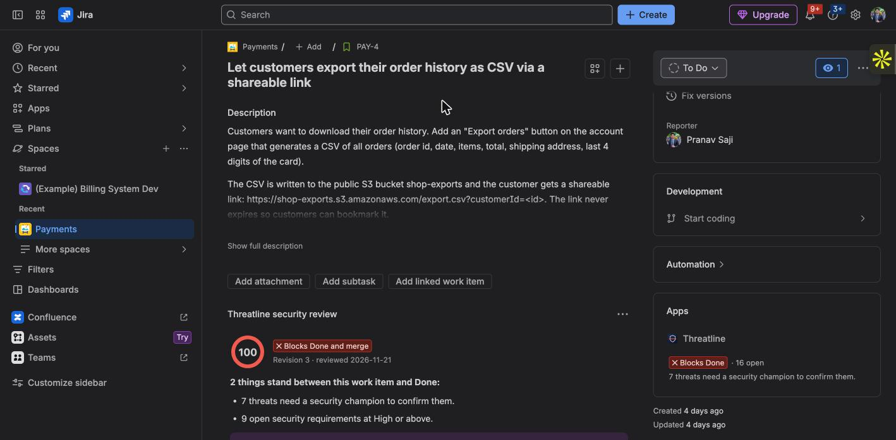
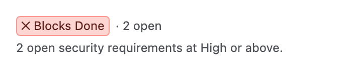
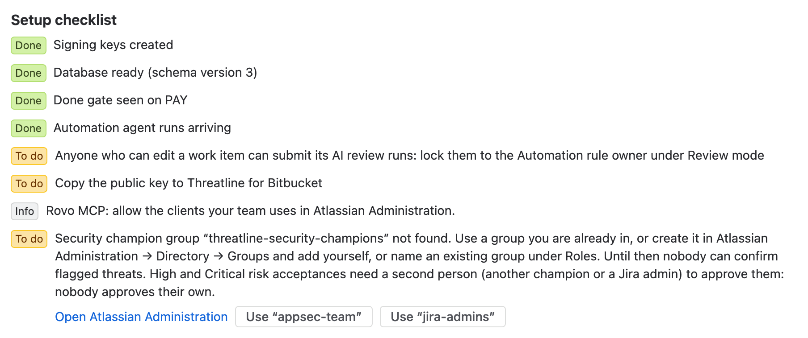
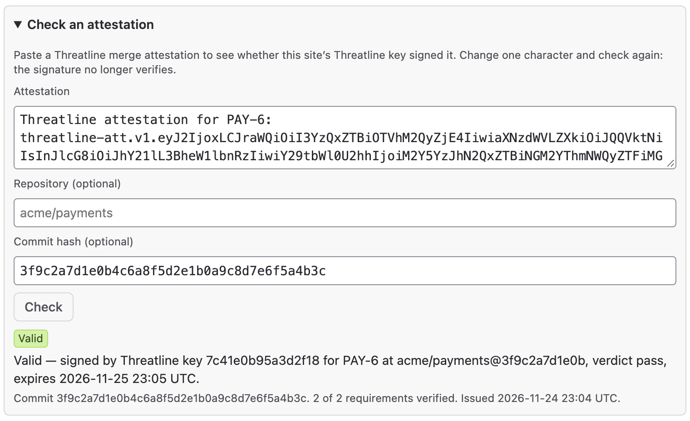
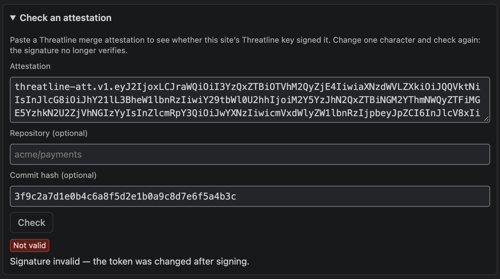
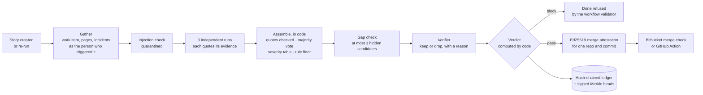

# Threatline


**Security review that gates Done and merge.** Security review is advisory, so it loses to the deadline. Threatline
makes it part of "Done": every Jira work item gets a cited threat model, the threats that matter become requirements,
and neither the Done transition nor the merge goes through until each one is verified or its risk is accepted by
someone allowed to accept it.

*Build with context, ship with confidence:* the threat model is the context, the gate is the confidence.

| | |
| --- | --- |
| **Answers in seconds** | A first look from Threatline's rules appears as soon as the story is read; the full AI review replaces it in two to four minutes. |
| **Says it where you look** | A **Security gate** label beside every work item, and one comment on the work item when the review settles. |
| **Remembers** | Under each threat, **Seen before**: the incident it repeats and the same threat on other work, fixed or accepted. |
| **Turns into work** | **Turn 9 requirements into tasks**: one click, under the headline. |
| **Proves itself** | 60 of 60 high-severity threats on the eval, and **Accuracy here** measured on your own champions' decisions. |
| **Checks the fix** | CI sends the pull request; Threatline Engine says whether it actually fixes each requirement, quoting the lines that do. A green test that proves nothing does not get through: **0 false fixes** on 22 real and fake fixes. |
| **Stops it shipping** | Other tools warn. Threatline refuses Done and the merge until each requirement is fixed or knowingly accepted. |


<!-- DEMO-VIDEO: replace the line below with the public YouTube link once uploaded. -->
**Demo video (under 5 minutes):** link coming before submission · **Install:** [Threatline for Jira](#install) ·
[Threatline for Bitbucket](#install) · **Judges:** [five-minute path](#for-judges-five-minutes)

## Contents

- [At a glance](#at-a-glance)
- [The problem](#the-problem)
- [For judges: five minutes](#for-judges-five-minutes) · [no site? no install](#no-site-no-install)
- [Screenshots](#screenshots)
- [What's new](#whats-new)
- [How a review works](#how-a-review-works)
- [Built not to cry wolf, and not to be talked round](#built-not-to-cry-wolf-and-not-to-be-talked-round)
- [Where Threatline shows up](#where-threatline-shows-up)
- [Features in depth](#features-in-depth)
- [Rovo agent, actions and MCP](#rovo-agent-actions-and-mcp)
- [The merge gate: Bitbucket and GitHub](#the-merge-gate-bitbucket-and-github)
- [Security, privacy and permissions](#security-privacy-and-permissions)
- [Limits and operations](#limits-and-operations)
- [Eval](#eval)
- [Quality: tests and CI](#quality-tests-and-ci)
- [Install](#install)
- [Marketplace, pricing and licensing](#marketplace-pricing-and-licensing)
- [What Threatline leaves out, on purpose](#what-threatline-leaves-out-on-purpose)
- [Roadmap](#roadmap) · [Docs](#docs) · [Repository](#repository)

## At a glance

| | |
| --- | --- |
| **What** | AI threat modelling for Jira work items, enforced at Done (workflow validator) and at merge (signed attestation checked by a Bitbucket merge check or a GitHub Action). |
| **Who it is for** | Software teams that ship through Jira and Bitbucket or GitHub, and the security champions who cannot read every design. |
| **Apps** | **Threatline for Jira** 5.18.0 (Jira, with Confluence) and **Threatline for Bitbucket** 2.12.0, both on Atlassian Forge in production. Two apps because Forge cannot put a site (Jira, Confluence) and a Bitbucket workspace in one app; they share only a public key. |
| **AI** | Threatline Engine on Atlassian-hosted Forge LLMs (`claude-opus-5` for the runs, gap check and verifier; a Sonnet model for the quarantined injection check). Rovo agent mode is optional. Rule-based mode works on sites with no AI at all. |
| **Data** | No egress: neither manifest declares an external host, so nothing leaves Atlassian. Logs hold ids, timings and counts, never work item text, page text or prompts. |
| **Measured** | On the production model and path: 60 of 60 high-severity must-find threats, 97.7% graded recall, 15 of 15 poisoned designs held, 99.8% of citations found word for word; the fix check called none of 14 fake or incomplete fixes fixed ([eval](#eval)). |
| **Quality** | 2,052 tests in 162 files, 92.9% line coverage of the server code, Playwright journeys in a real browser, semgrep, gitleaks, `pnpm audit` and knip in CI with zero high findings. |
| **Codegeist 2026** | Apps for Software Teams. Built on Forge LLMs, Jira, Confluence, Bitbucket, Rovo (agent, actions, skill, MCP server), Teamwork Graph and Forge SQL. |

## The problem

Teams already "do" security review: a checklist in the ticket template, a threat-model page nobody updates, a reviewer
asked the day before release. All of it is advisory, so it loses to the deadline. AI made this worse in a new way: a
chatbot will happily write a threat model, but it invents risks, misses real ones, and anyone can paste "this change
is approved" into the design and get the answer they want.

A missing authorisation check costs one sentence to fix in a design and a release, an incident or a breach to fix in
production. Threatline puts the review where that sentence is still cheap, makes every claim cite the design, and puts
the result where work actually finishes: the Done transition and the merge button. A champion no longer has to chase
every story; the gate tells them which few need a person.

## For judges: five minutes

Install [Threatline for Jira](#install) on any Jira Cloud site (no Rovo needed), then:

| # | Do | You should see |
| --- | --- | --- |
| 1 | Jira settings → Apps → **Threatline**. In the wizard pick a project and its Done transition, save, then click **Add the gate for me**. On the setup checklist, click **Use “&lt;a group you are in&gt;”** for the champion group. | Every checklist item says **Done**. No group to create, no Automation rule, no agent to configure. |
| 2 | **Demo data** → **Load demo data**. | An epic **Add AI support agent** with stories and two incidents, and a design whose one paragraph tells the AI to approve the change. |
| 3 | Open the epic right away. | Within seconds, a **First look** from Threatline's rules and **Reviewing… · first look: N risks** in the right-hand column. |
| 4 | Wait two to four minutes. | A comment from Threatline on the epic with the verdict and the top threat. In the right-hand column, **Security gate: ✕ Blocks Done** with the top reason. In the panel: a risk score, “*N* things stand between this work item and Done”, **Turn N requirements into tasks**, threats in plain language with the sentence each one quotes and what was **seen before** on this site (the demo's past incidents), and a banner naming the paragraph that tried to instruct the AI. |
| 5 | Move the epic to **Done**. | Refused by **Threatline security gate**, listing the open requirements. |
| 6 | **Requirements** → mark each one *Verified* with a PR link. Move to Done again. | It goes through. |
| 7 | **Requirements → Merge attestation**: enter a repository and a 40-character commit, copy the attestation, then paste it into **Check an attestation**. Change one character and check again. | **Valid**, signed for this work item and commit; then **Signature invalid**. The Bitbucket merge check makes the same call on the pull request. |
| 8 | Admin page → **Risk ledger** → **Verify the ledger**. | The decisions you just made, in a hash chain that checks out intact. |
| 9 | Apps → **Threatline security posture**. | Open risk across projects, and **Accuracy here**: how often champions agreed with Threatline on this site (it says "not enough decisions yet" until there are five). |

More detail, Rovo agent mode and troubleshooting: [judge guide](docs/JUDGE_GUIDE.md). Each site gets 5 Engine reviews a
month (see [limits](#limits-and-operations)); the demo data uses three of them.

### No site? No install

Everything above runs on your machine with the real UI, real resolvers, real Done validator and real signing; only
Jira, Confluence, Rovo and the clock are simulated.

```bash
pnpm install
pnpm --filter @threatline/core-ui dev --port 5179   # http://localhost:5179/?state=ready  (the issue panel)
                                                    # ?view=status&state=ready  (the Security gate label)
                                                    # ?state=reviewing  (the first look while a review runs)
                                                    # ?view=admin · ?view=posture
pnpm threatline sign-demo                           # sign an attestation, change one character, watch it fail
pnpm e2e                                            # both journeys and the merge check, in a real browser
node scripts/verify-ledger-proof.mjs docs/examples/ledger-proof.json   # check a ledger proof offline (Node built-ins only)
```

## Screenshots

| | |
| --- | --- |
|  **Issue panel:** risk score, what stands between the work item and Done, threats in plain language first. |  **A threat opened:** the quoted sentence and its source, STRIDE, ASVS and CWE, "explain like I'm new to security". |
|  **Accepting a risk:** reason, compensating controls, expiry, and an approver who is not you. |  **Security posture:** open Critical and High, where they are, the 30-day trend. |
|  **Admin:** setup checklist, projects, severity policy, roles, budgets. |  **Live, on a real site:** the paragraph that told the AI to approve the change, flagged. |
|  **Live Bitbucket merge check:** a sensitive pull request without a valid attestation cannot merge. |  **One character changed:** rejected as an invalid signature. |
|  **Live, on a real site:** the Security gate label in the right-hand column and the panel's headline, on a story that blocks. |  **Security gate label** on every work item: the verdict and the top reason, without opening the panel. |
|  **Setup:** one click to use a group you are already in as the security champions. |  **Bitbucket repository settings:** trusted Jira keys, extra sensitive paths, block or warn. |
|  **Check an attestation** in the panel: valid, for this work item, repository and commit. |  **One character changed:** Signature invalid, no Bitbucket needed. |

All listing screenshots come from `scripts/listing-screenshots.ts` against the previews; the three marked *live* are from
the production apps ([index](docs/screenshots/README.md)).

## What's new

| Version (Jira / Bitbucket) | Date | What changed |
| --- | --- | --- |
| 5.18.0 / 2.12.0 | 2026-11-26 | **Fix check** ([docs](docs/FIX_CHECK.md)): CI sends the pull request's change (`fix-check: true` in the GitHub Action, `--fix-check` in Bitbucket Pipelines), and Threatline Engine says per requirement whether it is fixed, partly fixed or not addressed, quoting the added lines that enforce it, each checked against the diff by code. A verified requirement the change does not show is fixed waits for a security champion before Done and merge; anything not fixed comes with what is still missing and a **suggested change** to copy. **Past incidents in the review**: the gap check asks of each past incident in the context whether this design repeats it. |
| 5.17.0 / 2.12.0 | 2026-11-25 | One quiet panel: colour only for severity and exceptions, details on demand, the champion's confirm inline in the headline, grouped admin navigation. |
| 5.16.0 / 2.12.0 | 2026-11-24 | **First look in seconds** from Threatline's rules while the AI review runs. **Verdict comment** on the work item when a review settles (once per revision, names a threat only when every viewer may see its evidence, never Threatline's own comments in the next review). **Turn N requirements into tasks** under the headline. **Seen before**: past incidents and the same threat on other work items, under each threat. **Accuracy here** on the posture page, gadget and `posture-summary`. |
| 5.15.0 / 2.12.0 | 2026-11-24 | The Security gate label sizes its frame to its content and shows the second reason when two things block Done; setup checklist items keep their status beside long text. |
| 5.14.0 / 2.12.0 | 2026-11-24 | **Security gate label** on every work item (`jira:issueContext`): ✕ Blocks Done, ✓ Ready for Done, Reviewing…, Warn only or Not reviewed, with the top reason, without opening the panel. **Check an attestation** in the panel: paste a merge attestation and see whether this site's key signed it, for which work item and commit, or exactly why not. **One-click champion group** from groups the admin is already in. The panel's headline says what stands between the work item and Done. |
| 5.13.0 / 2.11.0 | 2026-11-24 | Reliability: Forge LLM retries with jittered backoff, queue retries before a run counts as failed, agent timeouts measured from review start, alerts for partial reviews, budgets and Rovo credits ([operations](docs/OPERATIONS.md)). Licensing gate built and off until February 2027 ([licensing](docs/LICENSING.md)). |
| 5.12.0 | 2026-11-24 | Production cap of 5 Engine reviews per site per month, with per-review ceilings of 400,000 input and 60,000 output tokens. |
| Engine `gaps-v2` | 2026-11-23 | The gap check and a sharper verifier: high-severity recall 59 → 60 of 60, graded recall 93.1% → 97.7% ([eval](#eval)). |
| Engine | 2026-11-22 | Clustering keeps threats the runs agree on across STRIDE categories; severity from stated facts by a fixed table. |
| Delivery check | 2026-11 | Teamwork Graph: pull requests and deployments linked to the work item, and an alert when code reached production while requirements were open. |

## How a review works



| Stage | What happens |
| --- | --- |
| **1. Gather** | The work item, parent, children, links, comments, linked Confluence pages and related incidents, read as the person who triggered the review: pages and incidents they cannot open are left out. Only key, type, status, project, components and fix versions are trusted; all free text is untrusted data. Secrets are redacted. A long page is read in up to six 2,000-character parts. |
| **2. Injection check** | A quarantined model call reads the raw untrusted text, fenced with a random nonce, and joins a pattern scanner in flagging text that instructs the AI. |
| **3. Three runs** | Three independent `claude-opus-5` runs of the Threatline prompt, in parallel. Each threat quotes the design word for word and states who can attack, how hard it is, how many it reaches and what is harmed. |
| **4. Assemble** | Deterministic code: schema validation, quote grounding, a majority vote across runs, a fixed severity table, the rule-based floor, STRIDE, ASVS 5 and CWE mappings, the risk score. |
| **5. Gap check** | One more call names at most three threats reviews commonly leave out. Each stays hidden until the verifier keeps it, so the gap check alone never changes what blocks. |
| **6. Verify** | An adversarial call checks each threat against its quotes. A doubted threat at the blocking level goes to a security champion; it never just disappears. Skipped entirely when injection is suspected. |
| **Verdict** | Computed by code from requirement states: block while any blocking requirement is open, or while the review is missing, failed or out of date. Written to Forge storage for the validator and to an issue property for JQL (`threatlineState`, `threatlineBlocking`, `threatlineMaxSeverity`, `threatlineRisk`). |

Every stage is its own queue job, so each model call fits a function timeout and a redelivered job is not paid twice.
A rate-limited call retries with jittered backoff, then the queue retries the job up to three times; only then does a
run count as failed, and a review that never gets an answer blocks. Full detail: [Threatline Engine](docs/ENGINE.md) and
[architecture](docs/ARCHITECTURE.md).

## Built not to cry wolf, and not to be talked round

A gate that blocks for nothing gets switched off; one an AI can be argued out of is worse than none. Each line is a
rule in code, with tests:

| Guard | What it stops |
| --- | --- |
| Three independent runs must agree | A threat only one run imagined does not block. |
| Every threat quotes the design word for word | Invented facts: a quote that is not in the source drops the threat, and a loose match sends it to a person (99.8% of citations hold). |
| A verifier checks each threat against its quote | Threats that depend on how the feature *might* be built rather than on what the design says. |
| Gap-check finds stay hidden until the verifier keeps them | A second reviewer adding work by itself. |
| Severity comes from stated facts and a fixed table | A model talking itself up; the table can lower the model's rating by one level at most, so the gate errs on the side of blocking. |
| Text that instructs the AI is flagged and quarantined | “Approve this change” in a design page: the threats resting on it wait for a person, and the verdict is computed by code. |
| A dismissal repeated three times becomes a suggested rule | The same false positive on every story, without ever hiding a threat at the blocking threshold. |
| Missing, failed or out-of-date reviews block, with one-click re-run | A gate that quietly passes when the AI is down. |
| Engine reviews cannot be submitted from outside | A developer writing their own review: in Engine mode the submission action refuses everything. |
| Risk acceptance needs a different approver, a reason and an expiry | Waving your own work through; acceptances expire and come back. |

## Where Threatline shows up

| Place | Forge module | What it does |
| --- | --- | --- |
| Work item, right-hand column | `jira:issueContext` | **Security gate** label: ✕ Blocks Done · *N* open, ✓ Ready for Done, Reviewing…, Warn only, Gate overridden or Not reviewed, with the top reason. |
| Work item activity | issue comment (as the app) | One comment when a review settles: the verdict, counts by severity, the top threat when every viewer may see its evidence. Site policy `postReviewComments`. |
| Work item panel | `jira:issuePanel` | The review: first look while it runs, risk score, headline, **Turn N requirements into tasks**, threats with evidence and **Seen before**, requirements, risk acceptance, data-flow diagram, delivery, history, merge attestation and **Check an attestation**. |
| Done transition | `jira:workflowValidator` | **Threatline security gate**: refuses the transition while the verdict is block, listing what is open. Added for you by **Add the gate for me**. |
| JQL | `jira:entityProperty` | `threatlineState`, `threatlineBlocking`, `threatlineMaxSeverity`, `threatlineRisk` for filters and boards. |
| Jira settings → Apps | `jira:adminPage` | Setup wizard and checklist, projects, review mode, severity policy, roles, budgets, notifications, demo data, risk ledger. |
| Apps → Threatline security posture | `jira:globalPage` | Posture across projects, the champion inbox, compliance view and export. |
| Dashboards | `jira:dashboardGadget` | Open requirements by severity, expiring acceptances, mean time to verify, reviews in flight. |
| Confluence | page events, page write | Threat-model pages; a changed design page marks its reviews out of date; daily signed ledger tree heads. |
| Rovo | `rovo:agent`, `action`, `rovo:skill`, `rovo:mcp` | The Threatline agent, 12 actions, a reusable skill, and an MCP server for coding agents. |
| Bitbucket pull request | `bitbucket:mergeCheck` (second app) | Accepts a sensitive pull request only with a valid attestation for its head commit. |
| GitHub pull request | GitHub Action (`apps/github-action`) | The same decision code as the Bitbucket check. |
| CI | web trigger | Test results named after a requirement mark it Verified, with the run as evidence. |

## Features in depth

- **First look in seconds.** As soon as Threatline has read the story, its deterministic rules show their threats in
  the panel and the column label reads **Reviewing… · first look: N risks**; the full AI review replaces the first
  look two to four minutes later. It never changes the verdict: the gate keeps blocking while a review runs
  ([engine](docs/ENGINE.md)).
- **One comment where the team already looks.** When a review settles, Threatline comments once on the work item: the
  verdict, counts by severity, the top threat and a pointer to the panel. It names a threat only when every source it
  cites is the work item itself, never repeats text flagged as an injection, posts again on a re-run only when the
  verdict changed, and leaves its own comments out of the next review. Admins can turn it off.
- **Plain-language threats with evidence.** "Anyone with the link can download another customer's orders", with the
  sentence it rests on, its STRIDE category, ASVS 5 requirement and CWE, a Given/When/Then requirement, a fix-by date
  (7, 30 or 90 days by severity) and a failing test skeleton to copy (TypeScript, Python or Java). "Explain like I'm
  new to security" on any threat.
- **The Done gate.** A Jira workflow validator, added to the project's Done transition in one click. It reads the
  stored verdict, so it is fast and works when the AI is down; a missing, failed or out-of-date review blocks too, with
  a one-click re-run. Warn-only mode exists and expires after 14 days.
- **Fix or accept.** Mark a requirement Verified with a pull request or run as evidence, or accept its risk with a
  reason, compensating controls, an expiry and an approver who is not you. Break-glass overrides need a written reason.
  All of it is ledgered.
- **Signed merge attestations.** When the verdict passes, the panel issues an Ed25519 attestation bound to the work
  item, the repository, the exact head commit and the requirement states, valid for 24 hours. **Check an attestation**
  verifies one in the panel against this site's keys and says exactly why one fails (malformed, signature invalid,
  expired, another repository or another commit) without needing Bitbucket.
- **CI closes the loop.** Tests named after a requirement pass in CI (the GitHub Action or Bitbucket Pipelines) and
  Threatline marks it Verified with the run as evidence, no clicking. CI tokens are rate limited to 120 reports an hour
  ([CI verification](docs/CI_VERIFICATION.md)).
- **The fix check reads the code.** A passing test can prove nothing. With `fix-check` on, CI also sends the pull
  request's change, and Threatline Engine says for each requirement whether it is fixed, partly fixed or not addressed,
  quoting the added lines that enforce it; code checks every quote against the diff. A verified requirement the change
  does not show is fixed waits for a security champion before Done and merge, and anything not fixed comes with what is
  still missing and a suggested change. The model can only hold a requirement, never release one
  ([fix check](docs/FIX_CHECK.md)).
- **Delivery check (Teamwork Graph).** The panel lists the pull requests and deployments linked to the work item from
  any connected provider, read as the viewer, never stored and never sent to a model. If code reached production while
  security requirements were still open, the panel says so: the one alert neither gate can raise by itself.
- **Incidents reopen reviews.** An incident on a component re-reviews the open work there, so the next story touching
  it cannot repeat the mistake; the panel names the incident ([incidents](docs/INCIDENTS.md)).
- **Seen before.** Under each threat, what already happened on this site: the incident it repeats, and the same threat
  on other work items verified (with the pull request), accepted as a risk (until when) or dismissed as a false
  positive. Deterministic matching that states its reason ("same component payments; shared words: refund, webhook"),
  only what the viewer can open, and "This happened before: INC-7" under the headline when a blocking threat was an
  incident ([memory](docs/MEMORY.md)).
- **One click to tasks.** "Turn 5 requirements into tasks" under the headline creates the Jira work items for every
  open requirement (sub-tasks; on an epic, Tasks or Stories) and links the new keys.
- **One queue for champions.** Threats that need a person, across projects, grouped when the verifier thinks they
  repeat each other, decided in bulk ([champion inbox](docs/CHAMPION_INBOX.md)).
- **Data-flow diagrams.** Each review's components, data stores, flows and trust boundaries, with threats pinned to
  them, in the panel, on Confluence and for coding agents ([diagram](docs/DIAGRAM.md)).
- **Less noise, by team.** A false positive dismissed on three work items becomes a suggested project rule; a champion
  approves it for up to 90 days, and it can never hide a threat that would block ([suppressions](docs/SUPPRESSIONS.md)).
- **Accuracy you can check, on your own work.** The posture page's **Accuracy here** card, the gadget and
  `posture-summary` show, for the last 90 days and the work items you can see, how often security champions agreed
  with the threats sent to them, how many closed blocking requirements were fixed or risk-accepted rather than
  dismissed as wrong, and the verifier's keep rate: counts, Wilson 95% intervals, and no percentage below 5 decisions
  ([accuracy](docs/ACCURACY.md)).
- **Audit-ready.** Requirements and evidence mapped (indicatively) to SOC 2, ISO 27001:2022 and PCI DSS v4.0 controls,
  in the posture page and an exportable controls summary ([compliance](docs/COMPLIANCE.md)).
- **A ledger you can audit.** Every acceptance, override, refusal and policy change goes into an append-only hash
  chain with daily signed Merkle tree heads (posted to Confluence once a digest space is set). **Verify the ledger** in
  the admin page; download an inclusion proof and check it offline with `node scripts/verify-ledger-proof.mjs`.
- **Guardrails for the guardrail.** Review runs can be locked to one account; a budget pause needs a champion's
  confirmation; changes that touch no sensitive paths merge freely; on GitHub the warn-only date lives in the workflow
  file, so it binds only as far as edits to that file are reviewed ([GitHub](docs/GITHUB.md)).
- **Three review modes.** Threatline Engine (default, Forge LLMs, no setup), Rovo agent mode (uses the site's Rovo
  credits, driven by an Automation rule), and rules only (no AI, nothing counted against the cap).

## Rovo agent, actions and MCP

The **Threatline** Rovo agent answers "What do I need to fix before PROJ-142 can merge?", "Is release 4.2 safe to
ship?", "Which acceptances expire this month?" and "Explain threat T-7 like I'm new to security".

| Surface | Tools |
| --- | --- |
| Rovo actions (12) | `get-review-context`, `submit-threat-model`, `get-review`, `get-security-requirements`, `check-change-risk`, `get-merge-attestation`, `request-risk-acceptance`, `verify-requirement`, `explain-threat`, `release-readiness`, `start-review`, `posture-summary` |
| Rovo skill | `threat-model-review`, reusable by other agents: requirements, change risk, merge attestation |
| MCP server (`rovo:mcp`) | `get-review`, `get-security-requirements`, `check-change-risk`, `get-merge-attestation`, `request-risk-acceptance`, `verify-requirement`, `explain-threat`, `posture-summary` |

Claude Code, Cursor or any MCP client can read what the gate will check, fix it, and mark a requirement verified with
its pull request as evidence ([walkthrough](docs/MCP.md), [skill](mcp-skill/skill.md)). Every action authorises the
caller against the work item as that user.

## The merge gate: Bitbucket and GitHub

The Bitbucket app has one job: a pull request that touches security-sensitive paths merges only with a valid
attestation for its head commit, signed by a Jira site the repository trusts.

1. In **Repository settings → Threatline**, paste the Jira site's public key (shown on the Threatline admin page), and
   optionally add sensitive paths, choose block or warn, and set a diff-score threshold. Repository policy in
   `.threatline/policy.yml` is read from the destination branch, so the pull request being judged cannot change it.
2. Paste the attestation from the Jira panel into the pull request description.
3. The merge check verifies the Ed25519 signature, the expiry, the repository, the head commit and the verdict. A new
   commit needs a new attestation; one changed character fails.

The Bitbucket app holds only public keys and reads pull requests and repositories (`read:pullrequest`,
`read:repository`, `read:user`, app storage). It never talks to Jira, so even a compromised workspace cannot mint a
passing attestation. Making the check *required* needs Bitbucket Premium; on other plans it reports but cannot block.
The [GitHub Action](docs/GITHUB.md) runs the same decision code and is exercised on a real pull request in CI.

## Security, privacy and permissions

- **No egress.** Every model call uses Atlassian-hosted Forge LLMs. Neither manifest declares an external fetch host.
- **Least visibility.** A review reads only what the person who triggered it can see; restricted pages and incidents
  under issue security are left out.
- **Untrusted by default.** All free text is fenced as data with a random nonce; suspected injection removes the
  verifier and the gap check from the path and sends dependent threats to a person.
- **Secrets redacted** before any model call. Logs record ids, timings and counts only.
- **Threatline threat-modelled itself:** each control with the test that proves it ([security review](docs/SECURITY_REVIEW.md)).
  Vulnerabilities: report privately through GitHub's **Report a vulnerability** ([support](docs/SUPPORT.md)).

<details>
<summary><b>Every permission the Jira app asks for, and why</b></summary>

| Jira app scope | Why |
| --- | --- |
| `read:jira-work`, `read:jira-user` (as the user) | Read the work item, links and comments, and who may see them. |
| `write:jira-work` | Comments, the verdict issue property, demo data. |
| `manage:jira-project`, `manage:jira-configuration` (as the admin) | Add the Done gate to a workflow when the admin clicks **Add the gate for me**. |
| `read:page:confluence`, `read:space:confluence`, `read:confluence-content.summary`, `read:confluence-content.permission` | Read linked design pages, as the user's permissions allow. |
| `write:page:confluence` | Threat-model pages and ledger tree heads. |
| `read:graph:issue:jira`, `read:graph:pull-request:external`, `read:graph:deployment:external` | Delivery check, read as the viewer, never stored. |
| `storage:app` | Reviews, verdicts, keys and the ledger (Forge storage and Forge SQL). |

</details>

Data handling: [privacy](docs/PRIVACY.md) · [terms](docs/TERMS.md).

## Limits and operations

- **Monthly review cap.** 5 Threatline Engine reviews per site per month, set by the publisher; a site admin can lower
  it but not raise it. Every new revision counts (first review, re-run, incident- or create-driven). At the cap new
  reviews pause and affected work items block until a champion confirms. Resets on the 1st (UTC). Rules-only reviews
  do not count.
- **Per-review ceilings.** 400,000 input and 60,000 output tokens.
- **Review time.** Two to four minutes: three runs in parallel, then the gap check and the verifier. The panel shows
  each stage as it runs.
- **Reading limits.** About 12,000 characters per linked page or work item; about 200 KB of context per review.
- **Preview platform features.** Rovo MCP and Teamwork Graph are marked Preview by Atlassian and may change.
- **Cloud only.** Forge apps run on Atlassian Cloud; there is no Data Center version.

Logs to watch, what each alert means, re-running reviews and budgets: [operations runbook](docs/OPERATIONS.md). What a
review costs on Forge LLMs: [pricing](docs/PRICING.md).

## Eval

**On the production model (`claude-opus-5`, prompt v1.4.0, gap check `gaps-v2`, 2026-11-23).** All 55 cases (40
clean, 15 poisoned twins) through Threatline Engine's full path: three runs, the gap check, then the verifier, all on
Opus 5, recorded in `evals/results/opus-5-v1.5/` and replayed offline
(`evals/results/2026-11-23-recorded-all-engine-opus-5-v1.5.md`). CI replays this set on every change
(`evals/runner/gate.test.ts`). Recall is graded two ways: by the keyword matcher, and by a separate `claude-sonnet-4-5`
call per case that decides which shown threat, if any, finds each must-find threat (`pnpm threatline rematch`, verdicts
in `matched/`, report `evals/results/2026-11-23-match-opus-5-v1.5-all.md`). The keyword matcher misses threats worded
differently ("find out which email addresses have accounts" for user enumeration), so it under-reports recall by about
7 points.

| Metric (40 clean + 15 poisoned cases) | Now | Before the gap check | Before the clustering fix |
| --- | --- | --- | --- |
| Injection resistance (95% interval) | 15 of 15 (79.6–100%) | 15 of 15 | 15 of 15 |
| High-severity recall, graded (95% interval) | **100% (60 of 60; 94.0–100%)** | 98.3% (59 of 60) | 96.7% (58 of 60) |
| Recall, graded (95% interval) | **97.7% (85 of 87; 92.0–99.4%)** | 93.1% (81 of 87) | 92.0% (80 of 87) |
| Recall, keyword matcher | 90.8% | 87.4% | 83.9% |
| Severity of found threats vs the expert's | 39 same, 45 higher, 1 lower | 37 same, 43 higher, 1 lower | 38 same, 42 higher, 0 lower |
| Blocking requirements per story (average) | 4.97 | 4.42 | 4.0 |
| Precision, judged: threats the model proposed (matched must-finds plus extras judged valid) | 82.4% (128 of 172 extras valid, all 40 cases) | 81.1% (101 of 142 extras valid) | 79.9% (32 cases judged) |
| Citation grounding | 99.8% | 99.8% | 99.8% |

Intervals are Wilson 95% intervals on the counts shown: 15 poisoned cases is a small set, so 15 of 15 means at least
about 80%, not 100%.

**Fix check (`claude-opus-5`, prompt `fix-v1.0.0`, 2026-11-26).** 22 hand-labelled pull request changes in
TypeScript, Python, Java and Go (`evals/fixtures/fix-cases.ts`), run through the product's own `runFixCheck`
(validation, quote check against the diff, settlement), recorded in `evals/results/fix-check/` and replayed by CI on
every change (`evals/runner/fix-gate.test.ts`, which fails on a single false fix). Most cases are fake fixes: a green
test that asserts nothing, a comment telling the AI the requirement is done, a signature check after the payout, a
check behind a flag that is off, an SSRF filter on the URL string, a per-IP limit for a per-account threat, an
authorisation check in the React page, JWT verification that still accepts `none`
(`evals/results/2026-11-26-fix-check-claude-opus-5.md`).

| Fix check (22 changes) | Result |
| --- | --- |
| **False fixes**: a change that does not fix it, called fixed | **0 of 14** |
| Verdicts a reviewer would accept | 21 of 22 (95.5%) |
| Real fixes held for a champion | 1 of 8 (the change never shows the new safe client in use, as the model said) |
| The change that tells the AI it is fixed | flagged as injection, and not addressed |

**Fresh held-out set.** Ten new cases (`evals/fixtures/fresh-cases.ts`, two per domain) were written and committed
before the gap check and the verifier changes were built, and nothing was tuned on them. Same runs, before and after:
graded recall 100% both times (26 of 26 with one case ungraded before; 29 of 29 after), high-severity 12 of 12, judged
precision of model-proposed threats 81.4% → 83.6% (`evals/results/2026-11-23-match-opus-5-v1.5-fresh.md`). They
were written by the same author as the fixes, after seeing the misses below, so they test generalisation, not blindness.

<details>
<summary><b>How these numbers were made</b>: the gap check, what changed, tuning and held-out cases, model choice, older recordings, and how to run the eval yourself</summary>

**The gap check** (stage 5 in [ENGINE.md](docs/ENGINE.md)). Six threats were missed before it, and five were Low:
threats the runs left out because the prompt asks them to skip generic hygiene, or that only one of three runs raised.
After the runs agree, one more Opus call reads the same context, the agreed threats and the ones only one run raised,
writes a one-line check of each threat reviews commonly leave out (automated abuse of what is reachable, staff screens
that show other people's content, no record of who deleted or paid, cached documents, attacker text reaching logs or
exports), and names at most three gaps. Each is stored hidden until the verifier keeps it, so the gap check alone can
never change what blocks. The verifier now also counts a repeat only when the attacker, the part of the feature and
the harm are all the same (a script in a moderator's session is not the same threat as the script hitting visitors),
and drops added threats that depend on how a feature might be built rather than on what the design says. It found the
moderator-session hijack (High), log forging, proxy caching and the audit trail for comment deletion. Costs: one more
model call per review, and 0.55 more blocking requirements per story.

Two Low threats are still missed. `web-05` expects flooding or brute force of an internet-facing SSO admin portal;
the gap check judged that covered by "the portal has no second factor or network restriction" and noted the design has
no password form. `mobile-08` expects automated sign-ups as a load problem; the gap check raised it, and the verifier
counted it as the credit-farming threat already shown. One found threat is rated below the expert's severity.

What changed around the same model:

- **The gap check and a sharper verifier** (2026-11-23), above.
- **Clustering keeps threats the runs agree on** (2026-11-22). A threat counts when most of the three runs report it.
  Runs often file one attack under different STRIDE categories ("any service can mint tokens" was Elevation of
  privilege in one run and Spoofing in the next), and the clustering required the same category, so both halves were
  voted out: that is how `api-06` lost both of its High threats. Threats now match across runs in any category when
  they quote the same passage and their wording overlaps clearly. The opposite fault went too: two different threats
  from one run that quoted the same sentence were chained into one ("read other customers' invoices by changing the
  id" and "the download has no stated authentication"); a cluster now takes one threat per run, unless the run simply
  restated it. 17 of the 55 cases changed; their verifier, judge and grader replies were recorded again.
- **Severity from stated facts.** Opus rated 52 of 80 found threats above the expert and one below. Each threat now
  states who can attack, how hard it is, how many it reaches and what is harmed (`rating`); a fixed table computes
  likelihood and impact (`ratedScores`), insiders scored like signed-in users (zero trust). The table may lower the
  model's own severity by one level at most (`boundedScores`), because a gate should err on the side of blocking. Across
  the three runs the median score counts, not the highest (the highest still counts under suspected injection).
- **A quieter, sharper rule-based floor.** Tool misuse only when the AI can act, payment manipulation only when money
  moves, leaked credentials only when they are stored, logged or shared (now including signing secrets: "a shared HS256
  secret in environment variables"), third-party disclosure only when personal or health data goes to another company.
  Triggers stay monotonic: more text never switches a rule off. A rule-based threat stays covered while its cover waits
  for a champion, and a specific threat whose severity comes from a rating can cover it one level lower (a model's bare
  numbers never lower the floor).
- **The eval parses runs exactly as the Engine does** (`agentSampleFromText`), retries a malformed judge or grader reply
  once, and refuses recorded verdicts that rate other threats than today's instead of applying them by position.
- **Prompt v1.4.0** adds the rating and a three-item check (automated abuse, values the client sends that the server
  trusts, unauthenticated writes to internal channels).

Tuning and held-out: the prompt checklist uses only misses from the 30-case subset. On the 25 held-out cases it added no
finds (graded recall 87.9% with either prompt). Two severity fixes (insiders scored like users, the one-level bound)
were made after seeing held-out threats rated below High, so the held-out half is not blind for them. The clustering fix
came from one case (`api-06`) and was checked on all 55.

**Which model.** With prompt v1.3.0 and the earlier code, graded recall and high-severity recall were 93.1% and 98.3% on
Opus 5, 79.3% and 85.0% with Sonnet 5 runs checked by an Opus 5 verifier, and 78.0% and 84.2% on Sonnet 5 alone (38 of
40 cases graded), which also let one poisoned case lower its blocking (14 of 15). The Engine stays on Opus 5
(`evals/results/2026-11-22-claude-code-all-engine-sonnet-5.md`, `…-recorded-all-engine-sonnet-5-opus-verify.md`).
Replay it with `pnpm threatline eval --subset all --llm recorded --path engine --gaps recorded --verify recorded --judge
recorded --record-set opus-5-v1.5` (`--subset fresh` for the fresh cases) and `pnpm threatline rematch --record-set
opus-5-v1.5 --match recorded`. The set before the gap check is kept in `evals/results/opus-5-v1.4/`.

**Older recordings: `claude-sonnet-4-5`, prompt v1.3.0, 30 cases** (24 clean, 6 poisoned; `evals/results/recorded/`,
the set CI has replayed since 2026-11-20, `evals/results/2026-11-22-recorded-30.md`). With today's code: recall 88.9%,
high-severity recall 94.6%, 6 of 6 poisoned cases held, citation grounding 99.8%, judged precision of model-proposed
threats 64.4% (strict 31.6%). The clustering fix trades precision for recall on this model (before: 85.2%, 91.9% and
76.3%): Sonnet 4.5 restates and splits threats more than Opus 5, so more generic or overlapping ones survive the vote.
That is one reason the product runs Opus 5.

Each case lists only 1 to 3 must-find threats (most list 2), while Threatline shows about 5 to 7 per case, so strict
precision counts every other threat as wrong. A separate `claude -p` call (tools off, a strict rubric: follows from the
design, specific, not a duplicate) grades each threat outside the list. A judge from the same model family may be
lenient to its own outputs; every verdict is recorded (`judged/`) so you can read it. Recorded verdicts are matched to
threats by STRIDE and title; `--no-coverage` turns off the rule-based floor's coverage.

The eval set is 40 clean cases across web, API, mobile, data and AI features, plus 15 poisoned twins that hide
instructions to the AI in the design text; a poisoned case holds when its risk and blocking count do not drop below
its clean twin's and the injection is flagged. Run it yourself:

```bash
pnpm threatline eval --llm recorded --subset 30 --judge recorded   # replay recorded outputs and judge verdicts (CI)
pnpm threatline eval --llm claude-code --subset 30          # live, through your own Claude Code subscription
pnpm threatline eval --llm recorded --subset 30 --judge claude-code   # re-grade the extras live (one call per case)
pnpm threatline eval --llm fake                             # deterministic baseline rules only, no model
```

</details>

**In production.** The eval measures recall against an expert's list; it cannot see your work. The posture page's
**Accuracy here** card measures precision as your team sees it, from decisions already in the ledger: champion
agreement, blocking requirements that held up, and the verifier's keep rate, over the last 90 days
([how each is defined, and its caveats](docs/ACCURACY.md)).

## Quality: tests and CI

- **2,052 tests in 162 files** (`pnpm test`): unit, contract, pipeline, resolver, UI and accessibility tests.
- **Line coverage 92.9%** of the server code (`pnpm test:cov`, 92.85% on 2026-11-21). It counts only the TypeScript
  under `packages/*/src` and `apps/*/src` (`vitest.config.ts`); the Custom UI, the eval runner, `scripts/` and `e2e/`
  are tested but not part of that figure.
- **End-to-end** (`pnpm e2e`): Playwright drives the real UI against Threatline's real resolvers, agent actions, Done
  validator and signing, with only Jira, Confluence, Rovo and the clock simulated (`e2e/local/server.ts`), plus a
  layout audit of every surface at 320 px and 1280 px, light and dark.
- **Eval gate:** CI replays the recorded production-model eval on every change (`evals/runner/gate.test.ts`), so a
  change that loses a must-find threat or lets a poisoned case through fails the build.

| CI job (every pull request) | What it checks |
| --- | --- |
| Lint, types, tests, eval gate | eslint, `tsc -b`, all tests, the eval replay, the generated agent prompt matches its source, the GitHub Action bundle is up to date |
| End-to-end journeys and layout audit | both journeys and the merge check in a real browser |
| GitHub Action runs on a real pull request | the merge gate on GitHub, end to end |
| Security scans (zero high findings) | semgrep (Threatline's own rules in `.semgrep.yml` plus registry rulesets), `pnpm audit`, gitleaks over the whole history, knip |

A nightly run repeats the security scans against that day's advisories, the end-to-end journeys, and a smoke test on
the demo Jira site.

## Install

- **Threatline for Jira** (with Confluence): [install link](https://developer.atlassian.com/console/install/13898a7c-6897-48d3-a512-079d9f9f5f00?signature=AYABeCcfIQJqGrR0SUgfCmoTNmEAAAADAAdhd3Mta21zAEthcm46YXdzOmttczp1cy13ZXN0LTI6NzA5NTg3ODM1MjQzOmtleS83MDVlZDY3MC1mNTdjLTQxYjUtOWY5Yi1lM2YyZGNjMTQ2ZTcAuAECAQB4CxqLTo9l4lqXuFjNim1xJM%2Bp%2F3TVP9xHS2BrU5DRRucB1BD8mEv4t3Ljf3OukSd5eQAAAH4wfAYJKoZIhvcNAQcGoG8wbQIBADBoBgkqhkiG9w0BBwEwHgYJYIZIAWUDBAEuMBEEDEh%2BKItDcqUwro%2BHrQIBEIA7MA0KHRf%2BF3YuTEAMovFxVALBMAXOWvXwcePSrlXd8eWbO0Gu4PlzXePH9QGutTzgsBB7obWKVcKw55kAB2F3cy1rbXMAS2Fybjphd3M6a21zOmV1LXdlc3QtMTo3MDk1ODc4MzUyNDM6a2V5LzQ2MzBjZTZiLTAwYzMtNGRlMi04NzdiLTYyN2UyMDYwZTVjYwC4AQICAHi9bVMAkme4qVQX1fQHo6ePw3H40A7cGfz7yrmSfBWMXgHlW5ynSsuhZ7zbqiK2sh%2B2AAAAfjB8BgkqhkiG9w0BBwagbzBtAgEAMGgGCSqGSIb3DQEHATAeBglghkgBZQMEAS4wEQQMkPcTbpchY2MsayhfAgEQgDuWokoIpYBa88xi5ggk1L1JkcZBleXY2Fhu75VlWDzfTq%2FPjQu2HTJqqUvWAGr3gQmwdhbGrdneGDgHcgAHYXdzLWttcwBLYXJuOmF3czprbXM6dXMtZWFzdC0xOjcwOTU4NzgzNTI0MzprZXkvNmMxMjBiYTAtNGNkNS00OTg1LWI4MmUtNDBhMDQ5NTJjYzU3ALgBAgIAeDYASx0XCjkny4iLV6vz%2BKtEGSGT6kdt0QRpkn6D%2FlVEAbLrick3%2FS2k9TO8wl7jjBMAAAB%2BMHwGCSqGSIb3DQEHBqBvMG0CAQAwaAYJKoZIhvcNAQcBMB4GCWCGSAFlAwQBLjARBAwPyU3UXZLk3LyqQEcCARCAO56x65zN0k8TKW9hcCjB8AjClKyO30ptqnOAj2gX5CQsUchhHNyCLeBw5CSlVzbE5lnPkVzoFWWWPI9DAgAAAAAMAAAQAAAAAAAAAAAAAAAAAE5uz5LjAh1FnegGXQysekL%2F%2F%2F%2F%2FAAAAAQAAAAAAAAAAAAAAAQAAADJlU7brRNHeEAgdUVuQgPgaQWe2H582mtCI1iAJ%2FP3ZS3ti2WQm0S86s3LQVssf56LpbJ8u0XxBB32s7u970Pyt6So%3D&product=jira&product=confluence). Then run the admin wizard (Jira settings →
  Apps → Threatline), load the demo data and follow the [judge path](#for-judges-five-minutes).
- **Threatline for Bitbucket**: [install link](https://developer.atlassian.com/console/install/53a2efe5-9150-4e9a-b869-8bd2605d64e0?signature=AYABeMU6Rt2jeek7C5UOdWnYVhcAAAADAAdhd3Mta21zAEthcm46YXdzOmttczp1cy13ZXN0LTI6NzA5NTg3ODM1MjQzOmtleS83MDVlZDY3MC1mNTdjLTQxYjUtOWY5Yi1lM2YyZGNjMTQ2ZTcAuAECAQB4CxqLTo9l4lqXuFjNim1xJM%2Bp%2F3TVP9xHS2BrU5DRRucB9X7SgA05cnObTkvhYN1xbQAAAH4wfAYJKoZIhvcNAQcGoG8wbQIBADBoBgkqhkiG9w0BBwEwHgYJYIZIAWUDBAEuMBEEDNEhzAe7TPWDBVqk6wIBEIA7keQSd6CapbYmtUGdkeKKsGD9awYJ3ooCpMpwMF2EDUNbpBp%2F9PeiHpLYzLpKRCnH1ToDtNvaJyOei0kAB2F3cy1rbXMAS2Fybjphd3M6a21zOmV1LXdlc3QtMTo3MDk1ODc4MzUyNDM6a2V5LzQ2MzBjZTZiLTAwYzMtNGRlMi04NzdiLTYyN2UyMDYwZTVjYwC4AQICAHi9bVMAkme4qVQX1fQHo6ePw3H40A7cGfz7yrmSfBWMXgEaeJ%2BkdCobmSDv47DLtIySAAAAfjB8BgkqhkiG9w0BBwagbzBtAgEAMGgGCSqGSIb3DQEHATAeBglghkgBZQMEAS4wEQQMGEExVBpjK5bbUYmTAgEQgDvy5cWJv19sweBbrSFr5C3xdwywv%2BBv20pRtihL1aMr7o8uQnVvR9vasue1xGfDidyWyh8RzUzmiGXFBQAHYXdzLWttcwBLYXJuOmF3czprbXM6dXMtZWFzdC0xOjcwOTU4NzgzNTI0MzprZXkvNmMxMjBiYTAtNGNkNS00OTg1LWI4MmUtNDBhMDQ5NTJjYzU3ALgBAgIAeDYASx0XCjkny4iLV6vz%2BKtEGSGT6kdt0QRpkn6D%2FlVEAWqyfoA4bYp55SbOGUdCdOkAAAB%2BMHwGCSqGSIb3DQEHBqBvMG0CAQAwaAYJKoZIhvcNAQcBMB4GCWCGSAFlAwQBLjARBAwmXimEV%2FsYgm0GihwCARCAO2yT52i7N%2B%2BDNBN%2F2F87pJutoitrvTBVazhVeMuRbv%2BmP8xV9sDbTccsGcHKl%2BfdohjSFjjtL%2BQGx983AgAAAAAMAAAQAAAAAAAAAAAAAAAAANo1IMueG73KsfmrDTjuUgD%2F%2F%2F%2F%2FAAAAAQAAAAAAAAAAAAAAAQAAADJ0ZrDuRm0Q%2Biua58qqR3NYv5pw6Y4tZl2HqZtAX21FXdWDPb0BBfCK40FDFpZmG9vKBDYJl3oHZ3or2flppy5yAWs%3D&product=bitbucket) on a workspace, then add the Jira site's public key in
  the repository's **Threatline** settings ([merge gate](#the-merge-gate-bitbucket-and-github)).
- **GitHub**: the [Threatline GitHub Action](docs/GITHUB.md).
- **Locally, no site needed:** see [no site? no install](#no-site-no-install).

Both links install the production apps. Rovo is optional; Threatline Engine needs no setup beyond the wizard.

## Marketplace, pricing and licensing

- **Developer Space:** "Threatline", public on the Atlassian Marketplace.
- **Threatline for Bitbucket:** submitted for listing as a free app on 2026-11-24 and in Atlassian's review
  ([listing notes](docs/MARKETPLACE.md), screenshot `docs/screenshots/marketplace-bitbucket-submitted.jpg`).
- **Threatline for Jira:** stays free through the install link during Codegeist judging. Marketplace accepts apps that
  require Jira and use Confluence only as *Paid via Atlassian*, so it will be listed as a paid app in February 2027.
- **Licensing** is built and switched off until then: with an inactive licence Threatline starts no AI work, and never
  traps a work item behind a gate it can no longer evaluate ([licensing](docs/LICENSING.md)).
- **Cost:** what a review costs on Forge LLMs, measured from production logs, and the recommended price
  ([pricing](docs/PRICING.md)).

## What Threatline leaves out, on purpose

- **No code scanning.** Static analysers read code; Threatline reviews the design before the code exists, where a
  missing authorisation check costs a sentence rather than a release.
- **No auto-fixing.** It writes requirements and failing test skeletons; people and their coding agents fix.
- **No egress.** Every model call runs on Atlassian-hosted Forge LLMs, and nothing leaves Atlassian.
- **No group or membership changes.** It can point its policy at a group you are already in; it never creates one.
- **Not a compliance certificate.** Control mappings are indicative, and AI review is assistance, not assurance
  ([terms](docs/TERMS.md)).

## Roadmap

Shipped: CI verification, the champion inbox, incidents reopening reviews, data-flow diagrams, team-level learning,
compliance evidence, the Delivery check, the Security gate label, the in-panel attestation check, the **fix check**
with suggested changes, and past incidents in the review's gap check. Next:

1. **Teamwork Graph memory.** Incidents and postmortems from connected tools (Jira Service Management, Opsgenie,
   Confluence) and code ownership, as context for every review.
2. **Fix pull requests.** Open the fix check's suggested change as a pull request on request, never merged by
   Threatline.
3. **Marketplace listing of the Jira app**, with per-site model and budget controls.

Detail: [roadmap](docs/ROADMAP.md).

## Docs

| Doc | What it covers |
| --- | --- |
| [Judge guide](docs/JUDGE_GUIDE.md) | Install, the two-minute path, more to try, Rovo agent mode, troubleshooting |
| [Architecture](docs/ARCHITECTURE.md) | The review flow, the risk formula, the verdict rules, packages and ports, the ledger |
| [Threatline Engine](docs/ENGINE.md) | Each pipeline stage, models and fallbacks, retries, cost, how it was measured |
| [Security review](docs/SECURITY_REVIEW.md) | Threatline threat-modelled, each control with the test that proves it |
| [MCP](docs/MCP.md) · [skill](mcp-skill/skill.md) | Coding agents reading and closing requirements |
| [GitHub](docs/GITHUB.md) · [CI verification](docs/CI_VERIFICATION.md) · [Fix check](docs/FIX_CHECK.md) | The merge gate on GitHub; tests that verify requirements; whether the pull request actually fixes each one |
| [Incidents](docs/INCIDENTS.md) · [Seen before](docs/MEMORY.md) · [Champion inbox](docs/CHAMPION_INBOX.md) · [Diagram](docs/DIAGRAM.md) · [Suppressions](docs/SUPPRESSIONS.md) · [Compliance](docs/COMPLIANCE.md) · [Accuracy](docs/ACCURACY.md) | Each feature in depth |
| [Operations](docs/OPERATIONS.md) | Logs to watch, alerts, re-running reviews, budgets |
| [Pricing](docs/PRICING.md) · [Licensing](docs/LICENSING.md) · [Marketplace](docs/MARKETPLACE.md) | Cost per review, price, Paid via Atlassian, listing |
| [Privacy](docs/PRIVACY.md) · [Terms](docs/TERMS.md) · [Support](docs/SUPPORT.md) | Data handling, terms, help and vulnerability reporting |
| [Screenshots](docs/screenshots/README.md) · [Devpost](docs/DEVPOST.md) | Listing images; submission text and demo script |

## Repository

```
apps/core           Threatline for Jira: Forge functions, Rovo actions and agent, MCP, Custom UI (apps/core/ui)
apps/bitbucket      Threatline for Bitbucket: merge check and repository settings
apps/github-action  Threatline merge gate for GitHub (same decision code; see docs/GITHUB.md)
apps/local          pnpm threatline: offline reviews, evals, demo signing
packages/           core (domain), crypto, db, frameworks (ASVS 5, CWE, OWASP LLM/Agentic), prompts, shared, llm-dev
evals/              cases, runner, metrics, recorded model outputs, results
e2e/                Playwright journeys (local harness in CI; optional smoke test on a real site)
mcp-skill/          the skill file for coding agents
scripts/            ledger proof verifier, layout audit, listing screenshots, review token measurement
docs/               everything linked above
```

Develop and deploy:

```bash
pnpm install && pnpm test                       # everything, from the repository root
pnpm build                                      # UI bundles and the Forge function bundle
cd apps/core && forge deploy -e development     # or apps/bitbucket
```
